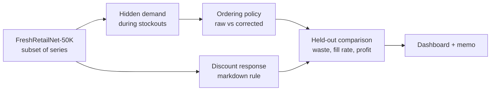

# Project map

## The question
How much better can a store order fresh products, and set markdowns, once it corrects for demand hidden by stockouts?

## How the pieces connect



## Folder map

```
fresh-food-ordering/
├── README.md              Decision and headline at the top (last day)
├── AGENTS.md, CLAUDE.md   Rules for the coding agent
├── DATA_REGISTER.md       Add download dates on day 1
├── AI_USE.md              Log AI use every day
├── requirements.txt       Pin versions on day 1
├── data/raw/              Downloaded source files (never committed)
├── data/processed/        Cleaned files and small result files
├── notebooks/
│   ├── 01_load_subset.ipynb
│   ├── 02_hidden_demand.ipynb
│   ├── 03_ordering_policy.ipynb
│   ├── 04_markdowns.ipynb
├── src/                   Reusable scripts
├── app/                   Streamlit dashboard
├── reports/               Two-page decision memo, charts
└── notes/                 Learning log, SQL log, this map
```

## Plan (2 days in the master plan)

| Day | Question answered | Output |
|---|---|---|
| 1 | How much demand do stockouts hide? | Subset loaded and checked; censored demand recovered; bias reproduced |
| 2 | What ordering and markdown policy wins? | Ordering simulation raw vs corrected, markdown rule, held-out results, dashboard, memo |

## The working loop for every step
Concept (Claude explains) → Spec (I write the agent prompt, Claude reviews) → Generate (agent codes on a branch) → Verify (I check numbers) → Review (pull request; CodeRabbit comments; I decide which to act on) → Explain back → Document → Merge.
